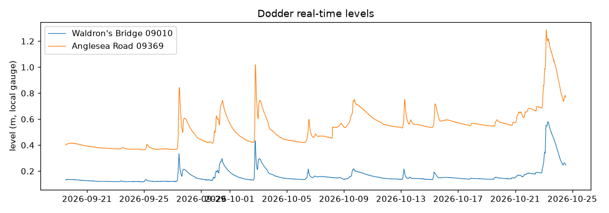
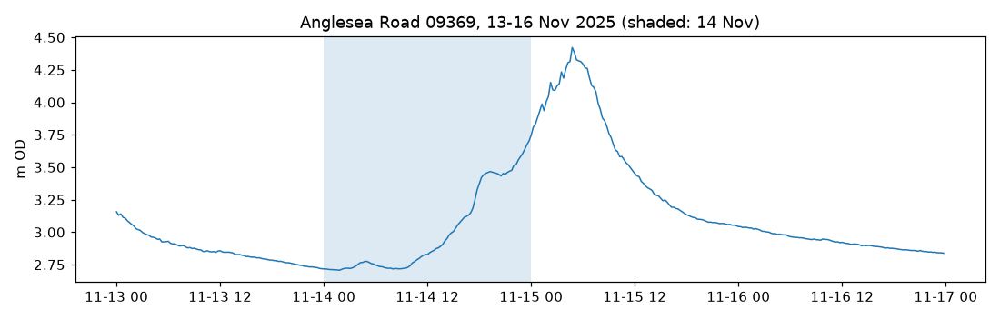

# Phase 1 data analysis

Generated by `analysis/phase1.py` from the curated Parquet (Hydro-Data snapshot 2026-10-24 plus the real-time
archive). All times are UTC. Water levels from Hydro-Data (`S`) are metres OD and equal the real-time `OD` sensor.

## 1. Coverage

| catchment | param | stations | earliest | total_rows |
|---|---|---|---|---|
| Dodder | S | 1 | 2021-10-06 | 177023 |
| Suir | Q | 13 | 1940-01-14 | 27456622 |
| Suir | S | 32 | 1940-01-14 | 41799590 |

Real-time only (not on Hydro-Data): Waldron's Bridge 09010, the six FFWS back-up loggers and Hollyford 16201.

| station_no | station_name | param | first | last | pct_checked | pct_provisional | pct_missing |
|---|---|---|---|---|---|---|---|
| 09369 | Anglesea Road | S | 2021-10-06 | 2026-10-23 | 93.2 | 6.2 | 0.6 |
| 16002 | Beakstown | S | 1954-10-01 | 2026-10-23 | 97.7 | 0.6 | 1.7 |
| 16009 | Caher Park | S | 1940-01-14 | 2026-10-23 | 81.6 | 0.5 | 1.2 |
| 16011 | Clonmel | S | 1953-10-24 | 2026-10-23 | 97.9 | 0.4 | 0.9 |
| 16002 | Beakstown | Q | 1954-10-01 | 2026-10-24 | 90.1 | 0.6 | 1.7 |
| 16009 | Caher Park | Q | 1940-01-14 | 2026-10-24 | 77.4 | 0.5 | 1.2 |
| 16011 | Clonmel | Q | 1972-02-18 | 2026-10-24 | 96.5 | 0.6 | 1.1 |

## 2. Waldron's Bridge (09010) to Anglesea Road (09369) lag

Data: real-time 15-min `0001` levels, 2026-09-19 12:00 to 2026-10-24 13:00
(3365 steps, 0 / 0 missing). Waldron's Bridge has no history on
Hydro-Data, so only the real-time archive (which began with the 2026-09-19 snapshot) can be used.

**Cross-correlation of 15-min changes** peaks at **30 min** (r = 0.75); r > 0.6 for 15-60 min.

**Event peak-to-peak** (4 events with a rise of at least 0.08 m at Waldron's Bridge):

| waldrons_peak | waldrons_m | rise_m | anglesea_peak | anglesea_m | lag_min |
|---|---|---|---|---|---|
| 2026-09-27 10:45:00+00:00 | 0.334 | 0.21400000000000002 | 2026-09-27 11:30:00+00:00 | 0.842 | 45 |
| 2026-09-30 11:00:00+00:00 | 0.296 | 0.149 | 2026-09-30 12:00:00+00:00 | 0.744 | 60 |
| 2026-10-02 18:45:00+00:00 | 0.433 | 0.302 | 2026-10-02 19:15:00+00:00 | 1.019 | 30 |
| 2026-10-23 06:45:00+00:00 | 0.581 | 0.39499999999999996 | 2026-10-23 07:45:00+00:00 | 1.219 | 60 |

Median peak lag: **52 min** (range 30-60 min, at 15-min
resolution). So the upstream gauge gives at most about 30-60 minutes of warning for Anglesea Road. Any
useful lead time on the Dodder has to come from rainfall forecasts, not from routing the upstream gauge.
This is only 5 weeks of autumn data. Re-run it as the real-time archive grows.

## 3. The 14 November 2025 event in the Anglesea Road record

- Rows 2025-11-13 to 2025-11-16: **384** (expected 384 at 15 min), gaps > 15 min: 0,
  missing values: 0. Quality codes: {31: 384} (31 = checked).
- On 14 Nov the level rose from 2.717 to 3.702 m OD (day max 3.702).
- The peak came after midnight: **4.422 m OD at 2025-11-15 04:45 UTC**.
- It is the **#2 independent peak** in the Anglesea record (2021-10-06 onwards). Top 5:

| day | max_m_OD |
|---|---|
| 2026-01-27 | 4.819 |
| 2025-11-15 | 4.422 |
| 2023-10-20 | 4.148 |
| 2026-02-06 | 3.842 |
| 2026-01-24 | 3.599 |

## 4. Rainfall source assessment for the Suir (OPW rain gauges)

24 OPW gauges within 15 km of a Suir forecast point, 15-min (5-min in the early years), 2005-08-09 onwards.
**97.9% of values are quality code 254 (unchecked)**: OPW has not quality-controlled
these rain records, so we have to.

QC (`river_forecast.features.rain_qc`): drop 15-min values > 50 mm, then compare each gauge-year with
the median of its 4 nearest gauges and flag: daily r < 0.6 (`low_corr`); a step change of
>= 1.6x in the gauge/neighbour ratio lasting >= 3 years (`step_bias`, the Rosegreen case);
or a single year > 1.5x off the gauge's own typical ratio (`ratio_outlier`). It iterates, so a bad
gauge doesn't get its neighbours flagged. Consistently wet upland gauges are *not* flagged.
**22 gauge-years flagged** ({'low_corr': 12, 'step_bias': 7, 'ratio_outlier': 3}).

| station_no | station_name | first | pct_provisional | spikes_gt_50mm | days_complete | r_vs_neighbours | ratio_vs_neighbours | flagged_years |
|---|---|---|---|---|---|---|---|---|
| 81623 | Cashel Wastewater Treatment  | 2005-10-13 | 99.9 | 0.0 | 5643 | 0.82 | 0.91 | - |
| 81605 | Cahir Wastewater Treatment P | 2005-11-29 | 99.7 | 0.0 | 5613 | 0.85 | 1.0 | - |
| 81630 | Dundrum Reservoir | 2010-06-02 | 99.2 | 0.0 | 5335 | 0.85 | 1.22 | low_corr: 2021 |
| 81614 | Rossadrehid Reservoir | 2005-08-09 | 99.7 | 0.0 | 5617 | 0.85 | 1.49 | - |
| 81611 | Knocknaree Nire Site | 2005-11-30 | 99.8 | 2.0 | 5731 | 0.86 | 0.92 | low_corr: 2021 |
| 81613 | Gortnahoe Waste Water Treatm | 2005-08-18 | 99.3 | 0.0 | 5669 | 0.87 | 1.07 | - |
| 81608 | Fethard Town Reservoir | 2005-10-26 | 99.7 | 0.0 | 5610 | 0.87 | 1.01 | low_corr: 2019 |
| 81601 | Cappaghnagarrane Reservoir | 2005-10-26 | 99.8 | 0.0 | 5802 | 0.87 | 1.06 | low_corr: 2012,2022,2024,2025 |
| 81621 | Stooke Reservoir | 2010-05-21 | 99.8 | 0.0 | 5442 | 0.88 | 1.27 | low_corr: 2017 |
| 81632 | Tournanena | 2018-08-08 | 99.9 | 1.0 | 2579 | 0.88 | 0.93 | ratio_outlier: 2020 |
| 81625 | Templetouhy Reservoir | 2010-03-09 | 88.9 | 0.0 | 5177 | 0.89 | 0.98 | - |
| 81636 | Feddans | 2020-08-28 | 99.9 | 0.0 | 2179 | 0.89 | 1.11 | - |
| 81616 | Killough Hill Reservoir | 2010-06-02 | 91.0 | 0.0 | 5602 | 0.89 | 0.82 | low_corr: 2019; ratio_outlier: 2020 |
| 81615 | Rosegreen Reservoir | 2010-05-21 | 99.1 | 0.0 | 5293 | 0.89 | 1.09 | low_corr: 2019; step_bias: 2020,2021,2022,2023,2024,2025,2026 |
| 81607 | Kilcoran Depot | 2005-11-29 | 99.8 | 0.0 | 5434 | 0.89 | 1.03 | - |
| 81602 | New Inn (Jamestown) | 2005-11-29 | 99.8 | 0.0 | 5532 | 0.89 | 0.88 | - |
| 81619 | Templemore Water Treatment P | 2010-03-15 | 88.8 | 0.0 | 5471 | 0.9 | 1.15 | low_corr: 2019,2024 |
| 81603 | Knockmealdown Mts. Water Tre | 2005-11-29 | 99.1 | 27.0 | 5291 | 0.9 | 1.57 | - |
| 81626 | Rathmoy Pumping Station | 2010-03-09 | 88.3 | 0.0 | 5004 | 0.91 | 1.04 | ratio_outlier: 2019 |
| 81612 | Tooreen West Nire Site | 2005-11-30 | 99.7 | 0.0 | 5484 | 0.92 | 1.26 | - |
| 81606 | Garryduff, Ardfinnan | 2010-05-06 | 99.6 | 4.0 | 5421 | 0.92 | 0.99 | - |
| 81610 | Ballymacarbry Council Depot | 2005-11-30 | 99.8 | 0.0 | 5645 | 0.93 | 1.02 | - |
| 81609 | Knocklofty Bridge | 2005-11-29 | 99.6 | 0.0 | 5571 | 0.94 | 1.04 | - |
| 81635 | Clogheen Wastewater Treatmen | 2020-08-08 | 99.7 | 0.0 | 2170 | 0.94 | 1.06 | - |

**Water balance check (Clonmel 16011, 2,144 km²).** QC'd gauge-mean annual rainfall against runoff depth from
Hydro-Data discharge:

| year | gauge_mean_rain_mm | clonmel_runoff_mm | runoff_coef | loss_mm |
|---|---|---|---|---|
| 2011 | 990 | 611 | 0.62 | 378 |
| 2012 | 1245 | 803 | 0.65 | 442 |
| 2013 | 1019 | 615 | 0.6 | 404 |
| 2015 | 1229 | 765 | 0.62 | 465 |
| 2016 | 993 | 685 | 0.69 | 307 |
| 2017 | 1050 | 637 | 0.61 | 413 |
| 2018 | 1183 | 821 | 0.69 | 363 |
| 2019 | 1206 | 817 | 0.68 | 389 |
| 2020 | 1246 | 903 | 0.73 | 342 |
| 2021 | 1075 | 679 | 0.63 | 396 |
| 2022 | 1199 | 697 | 0.58 | 502 |
| 2023 | 1305 | 829 | 0.64 | 476 |
| 2024 | 1095 | 654 | 0.6 | 440 |
| 2025 | 1189 | 689 | 0.58 | 500 |

Mean runoff coefficient **0.64**, mean loss **416 mm/yr**. That is in line with
Irish actual evapotranspiration (roughly 400-450 mm), so the QC'd gauge mean is a credible catchment rainfall.
Using the *median* of gauges instead gives coefficients near 1.0, because the median of intermittent hourly rain
is biased low. Use means, or areal weighting, not medians.

**Response at Clonmel:** hourly gauge-mean rain correlates best with the *rise* in flow 5 h later, and
24-h rainfall correlates best with flow about 15 h later. Lead time from observed rain is therefore
several hours to about a day. That is enough to be useful, and HARMONIE (+48 h) extends it.

**Assessment:**
- *Strengths:* 24 gauges spread over the catchment, 15-min, real-time (same feed as the levels), 2005/2010
  onwards, CC BY 4.0, already in our archive, and the water balance closes after QC.
- *Weaknesses:* all unchecked (code 254). There are impossible spikes (e.g. Knockmealdown 81603 at 1,558 mm in
  15 min in 2025, Garryduff 81606 at 1,850 mm). Some gauges have bad periods, and some have persistent bias:
  Rosegreen 81615 reads about 2x its neighbours from 2019, now caught by the step-change check. Several gauges
  fail together in 2019, which may be a network-wide problem that year. Sites are low-lying (treatment plants,
  reservoirs), so the uplands (Galtees,
  Knockmealdowns, Comeraghs) are under-sampled.
- *Verdict:* **use the OPW gauges as the primary observed-rainfall input for the Suir**, with automated QC
  (spike, neighbour-correlation and neighbour-ratio checks) built into the transform. Cross-check against
  Met Éireann's documented daily climate-station data before relying on long-term totals. Use HARMONIE
  point forecasts for the future window. Note the train/serve mismatch: training uses gauge rain, inference
  uses forecast rain.
- The Dodder has **no OPW rain gauges** within 15 km. Its only open rainfall is Met Éireann synoptic stations
  (Casement, Phoenix Park, Dublin Airport).

