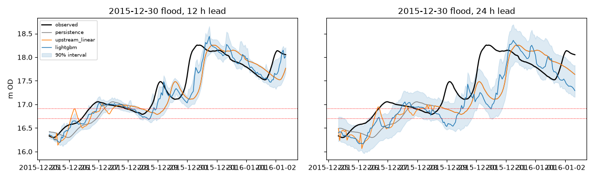
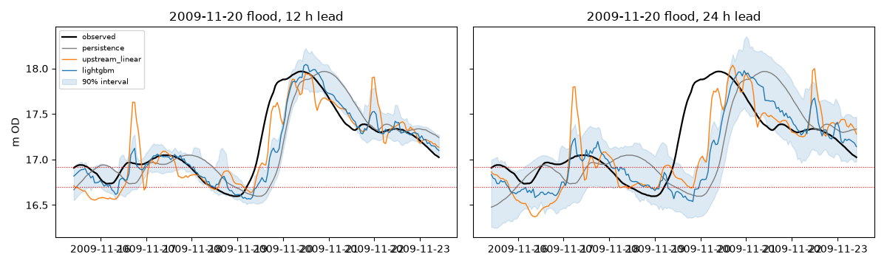
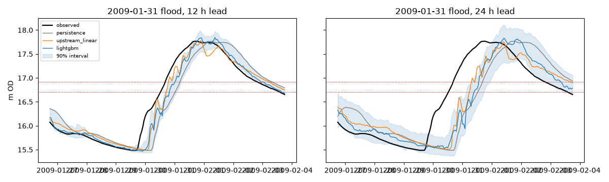
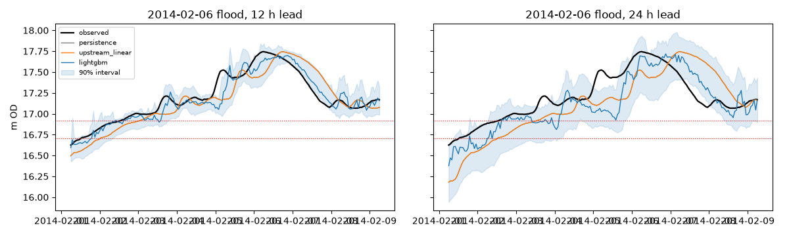

# Phase 2: Clonmel (16011) level forecasts

> **Superseded in part:** the upstream-linear results, the exceedance table and the intervals were corrected in
> [rerun/report.md](rerun/report.md) (DECISIONS D22). The persistence and LightGBM numbers here are unchanged.

Generated by `analysis/phase2.py` (2026-10-24). Hourly data 2006-01-01 to
2026-10-23; levels in m OD. Forecasts are of the Clonmel level at issue time + h.

## Set-up

- **Horizons 6, 12, 24, 48 h**, chosen from measured peak travel times to Clonmel (median over the 40
  largest events since 2006). Knocklofty about 4 h and Newcastle about 7 h, so **6 h** is about the main-stem
  lag and the ~5 h rain-to-rise lag. Caher Park about 9 h and New Bridge about 13 h, so **12 h**. Aherlow, Tar
  and Clodiagh 15-18 h, and Multeen, Clobanna and Nire 23-27 h, so **24 h** is the longest lead the gauge
  network can supply. **48 h** is beyond every travel time and is there to show where models stop beating
  persistence. It matches HARMONIE's +48 h, which we can't yet use because the forecast archive only began
  on 2026-10-24.
- **Splits (time only):** train < 2019, calibration (early stopping + conformal) 2019-2021, test >= 2022.
  The 8 largest independent floods since 2006 are cut out of train/calibration (peak -5 d/+3 d) and
  scored as backtests. Only one (2022-11) falls in the test period, two in calibration and five in the training
period, so most backtests are held-out *events*, not strictly forward-in-time forecasts.
- **Models:** persistence; upstream-lag linear model (OLS on Clonmel's and 8 upstream stations' level
  changes over 6/12/24 h, no rain); LightGBM on all upstream levels and changes, QC'd catchment rain over
  1 h-30 d, and season. Every model predicts the *change* in level, so the trees aren't asked to
  extrapolate absolute levels they never saw. Intervals: 90% conformalised quantile regression (5%/95%
  LightGBM quantiles, calibrated on 2019-2021, separately below and above the 10%-exceedance level).
- **Rain:** only *observed* rain up to issue time. No rainfall forecast is used, because none is archived
  yet. A separate LightGBM fed the *observed* future rain gives an upper bound for perfect rain forecasts.
  It isn't deployable and isn't counted as a result.

**Flood events.** Largest independent peaks in the whole Clonmel record (1953-), for context:

| peak_time | peak_m | in_window |
|---|---|---|
| 2015-12-30 08:00 | 18.257 | True |
| 2000-11-06 19:00 | 18.020 | False |
| 2004-10-29 06:00 | 18.015 | False |
| 2009-11-20 10:00 | 17.967 | True |
| 1995-03-11 01:00 | 17.802 | False |
| 1996-01-07 09:00 | 17.796 | False |
| 2009-01-31 18:00 | 17.767 | True |
| 2014-02-06 06:00 | 17.744 | True |
| 1990-02-07 14:00 | 17.678 | False |
| 2021-02-24 16:00 | 17.659 | True |

Held out as backtests (top 8 since 2006, where rain-gauge data exists):

| peak_time | peak_m | period |
|---|---|---|
| 2015-12-30 08:00 | 18.257 | train |
| 2009-11-20 10:00 | 17.967 | train |
| 2009-01-31 18:00 | 17.767 | train |
| 2014-02-06 06:00 | 17.744 | train |
| 2021-02-24 16:00 | 17.659 | cal |
| 2019-11-22 13:00 | 17.500 | cal |
| 2022-11-02 05:00 | 17.453 | test |
| 2008-01-11 08:00 | 17.419 | train |

The 2000 and 2004 floods (2nd and 3rd largest on record) pre-date the rain gauges and are not in the
modelling window.

## Checked vs provisional data

| set | hours | median abs dy 1h (mm) | p99.9 abs dy 1h (mm) | level p50 (m) | level max (m) |
|---|---|---|---|---|---|
| checked 2022-2025 | 39336 | 2.250 | 191.999 | 14.910 | 17.453 |
| provisional 2026 | 2712 | 1.000 | 165.022 | 14.450 | 15.847 |

Handling: (1) labels for training and calibration are **checked hours only**; (2) the same input
preprocessing (hourly means, spike removal at > 1.0 m/h, rain QC) is applied whatever the status, so
training and serving inputs go through the same pipeline; (3) provisional-label hours are scored separately
below. Clonmel's provisional data is almost all 2026 (OPW checks with a lag of months), so the provisional
set is ~4 months of mostly low flows. It tests input/label noise, not flood skill.

## Skill by horizon

NSE and KGE are on the forecast level. Because Clonmel's level is strongly autocorrelated, NSE is high even
for persistence. **Skill vs persistence** (MSE skill score, with a 5-95% weekly block bootstrap) is the
number that matters: 0 means no better than persistence.

**test, checked labels (2022-2026)**

| h | model | n | NSE | KGE | skill_vs_persist | skill_5% | skill_95% |
|---|---|---|---|---|---|---|---|
| 6 | persistence | 39139 | 0.982 | 0.991 | 0.000 | nan | nan |
| 6 | upstream_linear | 39139 | 0.991 | 0.996 | 0.522 | 0.468 | 0.573 |
| 6 | lightgbm | 39139 | 0.997 | 0.998 | 0.848 | 0.828 | 0.871 |
| 6 | lightgbm+perfect rain (bound) | 39139 | 0.998 | 0.997 | 0.870 | nan | nan |
| 12 | persistence | 39139 | 0.952 | 0.976 | 0.000 | nan | nan |
| 12 | upstream_linear | 39139 | 0.968 | 0.984 | 0.339 | 0.302 | 0.377 |
| 12 | lightgbm | 39139 | 0.981 | 0.986 | 0.614 | 0.580 | 0.656 |
| 12 | lightgbm+perfect rain (bound) | 39139 | 0.990 | 0.992 | 0.793 | nan | nan |
| 24 | persistence | 39139 | 0.886 | 0.943 | 0.000 | nan | nan |
| 24 | upstream_linear | 39139 | 0.907 | 0.953 | 0.182 | 0.160 | 0.205 |
| 24 | lightgbm | 39139 | 0.932 | 0.944 | 0.409 | 0.379 | 0.441 |
| 24 | lightgbm+perfect rain (bound) | 39139 | 0.976 | 0.977 | 0.788 | nan | nan |
| 48 | persistence | 39139 | 0.780 | 0.890 | 0.000 | nan | nan |
| 48 | upstream_linear | 39139 | 0.794 | 0.896 | 0.062 | 0.046 | 0.075 |
| 48 | lightgbm | 39139 | 0.822 | 0.862 | 0.189 | 0.153 | 0.230 |
| 48 | lightgbm+perfect rain (bound) | 39139 | 0.960 | 0.960 | 0.817 | nan | nan |

**test, provisional labels (2026)**

| h | model | n | NSE | KGE | skill_vs_persist | skill_5% | skill_95% |
|---|---|---|---|---|---|---|---|
| 6 | persistence | 2828 | 0.910 | 0.944 | 0.000 | nan | nan |
| 6 | upstream_linear | 2828 | 0.972 | 0.984 | 0.693 | 0.636 | 0.785 |
| 6 | lightgbm | 2828 | 0.990 | 0.987 | 0.889 | 0.769 | 0.910 |
| 6 | lightgbm+perfect rain (bound) | 2828 | 0.992 | 0.988 | 0.913 | nan | nan |
| 12 | persistence | 2828 | 0.829 | 0.896 | 0.000 | nan | nan |
| 12 | upstream_linear | 2828 | 0.881 | 0.931 | 0.302 | 0.252 | 0.505 |
| 12 | lightgbm | 2828 | 0.906 | 0.942 | 0.448 | 0.382 | 0.541 |
| 12 | lightgbm+perfect rain (bound) | 2828 | 0.967 | 0.981 | 0.808 | nan | nan |
| 24 | persistence | 2828 | 0.679 | 0.783 | 0.000 | nan | nan |
| 24 | upstream_linear | 2828 | 0.716 | 0.810 | 0.114 | 0.089 | 0.226 |
| 24 | lightgbm | 2828 | 0.731 | 0.813 | 0.160 | -0.092 | 0.236 |
| 24 | lightgbm+perfect rain (bound) | 2828 | 0.920 | 0.944 | 0.751 | nan | nan |
| 48 | persistence | 2828 | 0.620 | 0.751 | 0.000 | nan | nan |
| 48 | upstream_linear | 2828 | 0.618 | 0.734 | -0.005 | -0.040 | 0.103 |
| 48 | lightgbm | 2828 | 0.587 | 0.721 | -0.087 | -1.076 | 0.157 |
| 48 | lightgbm+perfect rain (bound) | 2828 | 0.873 | 0.901 | 0.666 | nan | nan |

**flood backtests (8 events, -5 d/+3 d)**

| h | model | n | NSE | KGE | skill_vs_persist | skill_5% | skill_95% |
|---|---|---|---|---|---|---|---|
| 6 | persistence | 1544 | 0.947 | 0.972 | 0.000 | nan | nan |
| 6 | upstream_linear | 1544 | 0.962 | 0.977 | 0.277 | 0.106 | 0.429 |
| 6 | lightgbm | 1544 | 0.992 | 0.996 | 0.850 | 0.816 | 0.883 |
| 6 | lightgbm+perfect rain (bound) | 1544 | 0.992 | 0.996 | 0.854 | nan | nan |
| 12 | persistence | 1544 | 0.828 | 0.915 | 0.000 | nan | nan |
| 12 | upstream_linear | 1544 | 0.894 | 0.948 | 0.384 | 0.220 | 0.530 |
| 12 | lightgbm | 1544 | 0.936 | 0.969 | 0.627 | 0.585 | 0.684 |
| 12 | lightgbm+perfect rain (bound) | 1544 | 0.956 | 0.978 | 0.743 | nan | nan |
| 24 | persistence | 1544 | 0.519 | 0.775 | 0.000 | nan | nan |
| 24 | upstream_linear | 1544 | 0.673 | 0.847 | 0.321 | 0.213 | 0.416 |
| 24 | lightgbm | 1544 | 0.684 | 0.857 | 0.342 | 0.231 | 0.463 |
| 24 | lightgbm+perfect rain (bound) | 1544 | 0.834 | 0.919 | 0.655 | nan | nan |
| 48 | persistence | 1544 | -0.163 | 0.507 | 0.000 | nan | nan |
| 48 | upstream_linear | 1544 | -0.017 | 0.559 | 0.126 | 0.075 | 0.187 |
| 48 | lightgbm | 1544 | -0.067 | 0.555 | 0.083 | -0.051 | 0.212 |
| 48 | lightgbm+perfect rain (bound) | 1544 | 0.462 | 0.749 | 0.538 | nan | nan |

## Flood backtests: peak timing and size

For each event and lead h, the *fixed-lead trace* (all forecasts issued h hours before each valid time) is
compared with the observed hydrograph over the event window. Timing in hours (+ = forecast peak late);
size in m (forecast - observed).

Median absolute error over the 8 events:

| h | persistence abs timing h | persistence abs size m | upstream_linear abs timing h | upstream_linear abs size m | lightgbm abs timing h | lightgbm abs size m |
|---|---|---|---|---|---|---|
| 6 | 6.000 | 0.000 | 6.000 | 0.013 | 3.500 | 0.027 |
| 12 | 12.000 | 0.000 | 12.000 | 0.003 | 8.000 | 0.077 |
| 24 | 24.000 | 0.000 | 20.000 | 0.007 | 15.000 | 0.105 |
| 48 | 48.000 | 0.000 | 48.000 | 0.114 | 43.500 | 0.253 |

Per event:

| event | obs_peak_m | h | persistence_timing_h | persistence_size_m | upstream_linear_timing_h | upstream_linear_size_m | lightgbm_timing_h | lightgbm_size_m |
|---|---|---|---|---|---|---|---|---|
| 2015-12-30 | 18.257 | 6 | 6.000 | 0.000 | 6.000 | 0.000 | 5.000 | 0.109 |
| 2015-12-30 | 18.257 | 12 | 12.000 | 0.000 | 12.000 | 0.000 | 10.000 | 0.186 |
| 2015-12-30 | 18.257 | 24 | 24.000 | 0.000 | 24.000 | 0.000 | 22.000 | 0.100 |
| 2015-12-30 | 18.257 | 48 | 48.000 | 0.000 | 48.000 | 0.000 | 46.000 | -0.299 |
| 2009-11-20 | 17.967 | 6 | 6.000 | 0.000 | -1.000 | -0.049 | -3.000 | 0.083 |
| 2009-11-20 | 17.967 | 12 | 12.000 | 0.000 | 3.000 | -0.020 | 3.000 | 0.077 |
| 2009-11-20 | 17.967 | 24 | 24.000 | 0.000 | 8.000 | 0.069 | 14.000 | 0.009 |
| 2009-11-20 | 17.967 | 48 | 48.000 | 0.000 | 39.000 | -0.277 | 38.000 | -0.091 |
| 2009-01-31 | 17.767 | 6 | 6.000 | 0.000 | 12.000 | -0.025 | 0.000 | 0.039 |
| 2009-01-31 | 17.767 | 12 | 12.000 | 0.000 | 3.000 | 0.005 | 15.000 | 0.077 |
| 2009-01-31 | 17.767 | 24 | 24.000 | 0.000 | 16.000 | -0.015 | 16.000 | 0.063 |
| 2009-01-31 | 17.767 | 48 | 48.000 | 0.000 | 57.000 | -0.227 | 41.000 | -0.090 |
| 2014-02-06 | 17.744 | 6 | 6.000 | 0.000 | 6.000 | 0.000 | 3.000 | 0.015 |
| 2014-02-06 | 17.744 | 12 | 12.000 | 0.000 | 12.000 | 0.000 | 9.000 | -0.036 |
| 2014-02-06 | 17.744 | 24 | 24.000 | 0.000 | 24.000 | 0.000 | 15.000 | -0.027 |
| 2014-02-06 | 17.744 | 48 | 48.000 | 0.000 | 48.000 | 0.000 | 26.000 | -0.187 |
| 2021-02-24 | 17.659 | 6 | 6.000 | 0.000 | 9.000 | -0.159 | 5.000 | -0.035 |
| 2021-02-24 | 17.659 | 12 | 12.000 | 0.000 | -9.000 | -0.201 | 3.000 | -0.113 |
| 2021-02-24 | 17.659 | 24 | 24.000 | 0.000 | 3.000 | -0.077 | 15.000 | -0.253 |
| 2021-02-24 | 17.659 | 48 | 48.000 | 0.000 | 23.000 | -0.404 | 49.000 | -0.458 |
| 2019-11-22 | 17.500 | 6 | 6.000 | 0.000 | 6.000 | 0.000 | 0.000 | -0.017 |
| 2019-11-22 | 17.500 | 12 | 12.000 | 0.000 | 12.000 | 0.000 | 1.000 | -0.034 |
| 2019-11-22 | 17.500 | 24 | 24.000 | 0.000 | 24.000 | 0.000 | 13.000 | -0.145 |
| 2019-11-22 | 17.500 | 48 | 48.000 | 0.000 | 48.000 | 0.000 | 39.000 | -0.418 |
| 2022-11-02 | 17.453 | 6 | 6.000 | 0.000 | 6.000 | 0.000 | 12.000 | 0.016 |
| 2022-11-02 | 17.453 | 12 | 12.000 | 0.000 | 12.000 | 0.000 | 18.000 | 0.089 |
| 2022-11-02 | 17.453 | 24 | 24.000 | 0.000 | 24.000 | 0.000 | 32.000 | -0.151 |
| 2022-11-02 | 17.453 | 48 | 48.000 | 0.000 | 48.000 | 0.000 | 56.000 | -0.360 |
| 2008-01-11 | 17.419 | 6 | 6.000 | 0.000 | 1.000 | -0.136 | 4.000 | 0.019 |
| 2008-01-11 | 17.419 | 12 | 12.000 | 0.000 | -14.000 | -0.026 | 7.000 | -0.062 |
| 2008-01-11 | 17.419 | 24 | 24.000 | 0.000 | -2.000 | 0.018 | 11.000 | -0.110 |
| 2008-01-11 | 17.419 | 48 | 48.000 | 0.000 | 22.000 | -0.326 | 49.000 | -0.207 |

## Exceedance detection and lead time

An onset is the first hour above the threshold (episodes < 48 h apart are merged). A model *catches* an onset at
lead h if its lead-h forecast exceeds the threshold within +-3 h of the onset. Lead time is the longest such h.
Persistence can only catch an onset once the level is already above the threshold, which means a lead of 0.
Scored over the test period (2022-) plus the backtest windows. False-alarm episodes are forecast exceedances
with no observed exceedance within 24 h, counted over the test period.

| threshold | model | onsets | caught@6h | caught@12h | caught@24h | caught@48h | median_lead_h | false_alarms@12h (test) | CSI@12h | false_alarms@24h (test) | CSI@24h |
|---|---|---|---|---|---|---|---|---|---|---|---|
| P1 (16.702 m) | persistence | 16 | 2 | 1 | 0 | 0 | 0.000 | 0 | 0.753 | 0 | 0.599 |
| P1 (16.702 m) | upstream_linear | 16 | 13 | 8 | 2 | 0 | 9.000 | 8 | 0.778 | 11 | 0.643 |
| P1 (16.702 m) | lightgbm | 16 | 16 | 9 | 3 | 0 | 12.000 | 3 | 0.865 | 4 | 0.694 |
| AMAX median (16.914 m) | persistence | 12 | 1 | 0 | 0 | 0 | 0.000 | 0 | 0.695 | 0 | 0.494 |
| AMAX median (16.914 m) | upstream_linear | 12 | 8 | 8 | 0 | 0 | 12.000 | 4 | 0.755 | 4 | 0.577 |
| AMAX median (16.914 m) | lightgbm | 12 | 10 | 5 | 0 | 0 | 6.000 | 0 | 0.862 | 0 | 0.668 |

## Prediction intervals (LightGBM, nominal 90%)

| set | h | coverage | mean_width_m |
|---|---|---|---|
| test, checked labels (2022-2026) | 6 | 0.859 | 0.040 |
| test, checked labels (2022-2026) | 12 | 0.872 | 0.134 |
| test, checked labels (2022-2026) | 24 | 0.874 | 0.321 |
| test, checked labels (2022-2026) | 48 | 0.870 | 0.520 |
| test, provisional labels (2026) | 6 | 0.613 | 0.018 |
| test, provisional labels (2026) | 12 | 0.767 | 0.066 |
| test, provisional labels (2026) | 24 | 0.887 | 0.162 |
| test, provisional labels (2026) | 48 | 0.930 | 0.261 |
| flood backtests (8 events, -5 d/+3 d) | 6 | 0.792 | 0.123 |
| flood backtests (8 events, -5 d/+3 d) | 12 | 0.690 | 0.303 |
| flood backtests (8 events, -5 d/+3 d) | 24 | 0.633 | 0.601 |
| flood backtests (8 events, -5 d/+3 d) | 48 | 0.611 | 0.987 |
| high flow (level >= 15.74 m), all test + backtests | 6 | 0.861 | 0.098 |
| high flow (level >= 15.74 m), all test + backtests | 12 | 0.823 | 0.287 |
| high flow (level >= 15.74 m), all test + backtests | 24 | 0.755 | 0.588 |
| high flow (level >= 15.74 m), all test + backtests | 48 | 0.705 | 0.934 |

Conformal quantiles (m) per regime: {"6": {"normal": 0.001489534825156534, "high": 0.00626977950923752}, "12": {"normal": -0.002980840040867485, "high": 0.006430989216415883}, "24": {"normal": -0.0053103488456361855, "high": 0.029851820218174174}, "48": {"normal": -0.0002908536861500055, "high": 0.08556419525738385}}

Upstream-linear fallback-to-persistence rate (missing upstream inputs), all hours: {6: 0.321, 12: 0.321, 24: 0.321, 48: 0.321}
LightGBM trees (early stopping): {6: 831, 12: 141, 24: 144, 48: 143}
Runtime 855 s.
