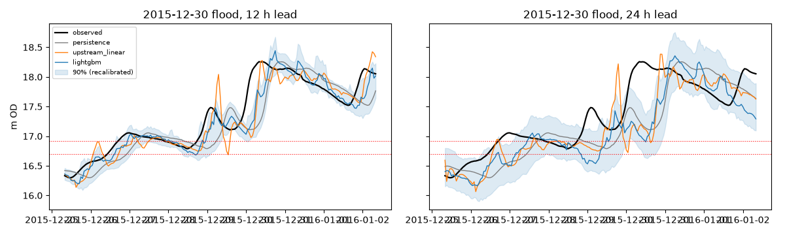
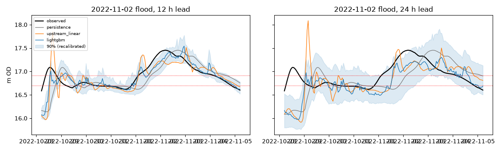

# Phase 2 re-run: corrected baseline, onset counting and flood intervals

Generated by `analysis/phase2_rerun.py` (2026-10-24). Same data, splits, features and LightGBM
settings as the first run (`docs/phase2/report.md`, which this supersedes for the linear model, the exceedance
table and the intervals). Models and predictions are saved this time. Every comparison below is on the **same rows**:
hours where all three models forecast and the observation exists.

## What changed

1. **Linear baseline: no silent fallback.** Each row uses the largest fitted subset of upstream stations that it has
   (40 sub-models); only if Clonmel's own data are missing is the forecast NaN, never persistence.
   Share of hours using the full 8-station model: 70% overall, 83% in 2022+, 63% in the flood windows
   (mean 7.6 of 8 stations in floods); rows with no forecast: 3.7% overall. The first run used persistence for 32% of hours and for 4 of 8 floods.
2. **Onset counting.** Onsets are found on the full continuous series (a data gap, the start of the record or the start of
   the scored period can no longer create one) and then filtered to the scored period. A unit test pins that
   persistence cannot catch an onset at leads beyond the +-3 h tolerance.
3. **Intervals.** See the last section: event-fold recalibration of the high-flow conformal correction.

| event | peak_m | interval_fold | linear_full_model_share | mean_stations |
|---|---|---|---|---|
| 2015-12-30 | 18.257 | 0 | 0.260 | 6.600 |
| 2009-11-20 | 17.967 | 1 | 1.000 | 8.000 |
| 2009-01-31 | 17.767 | 0 | 1.000 | 8.000 |
| 2014-02-06 | 17.744 | 1 | 0.000 | 7.000 |
| 2021-02-24 | 17.659 | 0 | 1.000 | 8.000 |
| 2019-11-22 | 17.500 | 1 | 0.800 | 7.800 |
| 2022-11-02 | 17.453 | 0 | 0.000 | 7.000 |
| 2008-01-11 | 17.419 | 1 | 1.000 | 8.000 |

## Skill by horizon (same rows for all models)

Skill = MSE skill score against persistence (0 = no better), with a 5-95% weekly block bootstrap. `v1` is the
first run's value (rows differ slightly: v1 used each model's own available rows).

**test, checked labels (2022-2026)**

| h | model | n | NSE | KGE | skill | 5% | 95% | skill_v1 |
|---|---|---|---|---|---|---|---|---|
| 6 | persistence | 39129 | 0.982 | 0.991 | 0.000 | nan | nan | 0.000 |
| 6 | upstream_linear | 39129 | 0.993 | 0.997 | 0.625 | 0.596 | 0.656 | 0.522 |
| 6 | lightgbm | 39129 | 0.997 | 0.998 | 0.848 | 0.828 | 0.871 | 0.848 |
| 12 | persistence | 39129 | 0.952 | 0.976 | 0.000 | nan | nan | 0.000 |
| 12 | upstream_linear | 39129 | 0.971 | 0.986 | 0.406 | 0.377 | 0.443 | 0.339 |
| 12 | lightgbm | 39129 | 0.981 | 0.986 | 0.614 | 0.580 | 0.656 | 0.614 |
| 24 | persistence | 39129 | 0.886 | 0.943 | 0.000 | nan | nan | 0.000 |
| 24 | upstream_linear | 39129 | 0.911 | 0.955 | 0.224 | 0.204 | 0.244 | 0.182 |
| 24 | lightgbm | 39129 | 0.932 | 0.944 | 0.409 | 0.379 | 0.441 | 0.409 |
| 48 | persistence | 39129 | 0.780 | 0.890 | 0.000 | nan | nan | 0.000 |
| 48 | upstream_linear | 39129 | 0.796 | 0.897 | 0.075 | 0.058 | 0.089 | 0.062 |
| 48 | lightgbm | 39129 | 0.822 | 0.862 | 0.189 | 0.153 | 0.230 | 0.189 |

**test, provisional labels (2026)**

| h | model | n | NSE | KGE | skill | 5% | 95% | skill_v1 |
|---|---|---|---|---|---|---|---|---|
| 6 | persistence | 2828 | 0.910 | 0.944 | 0.000 | nan | nan | 0.000 |
| 6 | upstream_linear | 2828 | 0.974 | 0.986 | 0.717 | 0.691 | 0.860 | 0.693 |
| 6 | lightgbm | 2828 | 0.990 | 0.987 | 0.889 | 0.769 | 0.910 | 0.889 |
| 12 | persistence | 2828 | 0.829 | 0.896 | 0.000 | nan | nan | 0.000 |
| 12 | upstream_linear | 2828 | 0.884 | 0.934 | 0.322 | 0.270 | 0.581 | 0.302 |
| 12 | lightgbm | 2828 | 0.906 | 0.942 | 0.448 | 0.382 | 0.541 | 0.448 |
| 24 | persistence | 2828 | 0.679 | 0.783 | 0.000 | nan | nan | 0.000 |
| 24 | upstream_linear | 2828 | 0.717 | 0.809 | 0.118 | 0.086 | 0.246 | 0.114 |
| 24 | lightgbm | 2828 | 0.731 | 0.813 | 0.160 | -0.092 | 0.236 | 0.160 |
| 48 | persistence | 2828 | 0.620 | 0.751 | 0.000 | nan | nan | 0.000 |
| 48 | upstream_linear | 2828 | 0.620 | 0.733 | -0.001 | -0.037 | 0.122 | -0.005 |
| 48 | lightgbm | 2828 | 0.587 | 0.721 | -0.087 | -1.076 | 0.157 | -0.087 |

**flood backtests (8 events)**

| h | model | n | NSE | KGE | skill | 5% | 95% | skill_v1 |
|---|---|---|---|---|---|---|---|---|
| 6 | persistence | 1544 | 0.947 | 0.972 | 0.000 | nan | nan | 0.000 |
| 6 | upstream_linear | 1544 | 0.966 | 0.978 | 0.353 | 0.177 | 0.476 | 0.277 |
| 6 | lightgbm | 1544 | 0.992 | 0.996 | 0.850 | 0.816 | 0.883 | 0.850 |
| 12 | persistence | 1544 | 0.828 | 0.915 | 0.000 | nan | nan | 0.000 |
| 12 | upstream_linear | 1544 | 0.907 | 0.954 | 0.456 | 0.337 | 0.542 | 0.384 |
| 12 | lightgbm | 1544 | 0.936 | 0.969 | 0.627 | 0.585 | 0.684 | 0.627 |
| 24 | persistence | 1544 | 0.519 | 0.775 | 0.000 | nan | nan | 0.000 |
| 24 | upstream_linear | 1544 | 0.674 | 0.848 | 0.322 | 0.198 | 0.434 | 0.321 |
| 24 | lightgbm | 1544 | 0.684 | 0.857 | 0.342 | 0.231 | 0.463 | 0.342 |
| 48 | persistence | 1544 | -0.163 | 0.507 | 0.000 | nan | nan | 0.000 |
| 48 | upstream_linear | 1544 | 0.017 | 0.572 | 0.155 | 0.102 | 0.221 | 0.126 |
| 48 | lightgbm | 1544 | -0.067 | 0.555 | 0.083 | -0.051 | 0.212 | 0.083 |

## Flood backtests: peak timing and size

Timing in hours (+ = forecast peak late), size in m (forecast - observed), on the fixed-lead trace. Persistence's peak is
the observed peak shifted by h, so its timing is h and its size error 0 by construction.

Median absolute error over the 8 events:

| h | persistence abs timing | persistence abs size | upstream_linear abs timing | upstream_linear abs size | lightgbm abs timing | lightgbm abs size |
|---|---|---|---|---|---|---|
| 6 | 6.000 | 0.000 | 10.500 | 0.051 | 3.500 | 0.027 |
| 12 | 12.000 | 0.000 | 12.000 | 0.081 | 8.000 | 0.077 |
| 24 | 24.000 | 0.000 | 9.000 | 0.073 | 15.000 | 0.105 |
| 48 | 48.000 | 0.000 | 38.000 | 0.225 | 43.500 | 0.253 |

Signed size error of the 48 h forecast, per event (negative = underestimates the peak):

| event | obs_peak_m | upstream_linear_size_m | lightgbm_size_m |
|---|---|---|---|
| 2015-12-30 | 18.257 | -0.135 | -0.299 |
| 2009-11-20 | 17.967 | -0.277 | -0.091 |
| 2009-01-31 | 17.767 | -0.227 | -0.090 |
| 2014-02-06 | 17.744 | 0.080 | -0.187 |
| 2021-02-24 | 17.659 | -0.404 | -0.458 |
| 2019-11-22 | 17.500 | -0.223 | -0.418 |
| 2022-11-02 | 17.453 | 0.205 | -0.360 |
| 2008-01-11 | 17.419 | -0.326 | -0.207 |

## Exceedance detection and lead time (corrected onset counting)

An onset is the first hour above the threshold after at least 48 h below it, with the previous hour observed. A forecast
catches it at lead h if the lead-h forecast exceeds the threshold within +-3 h of the onset (so the real advance
warning can be up to 3 h shorter than the nominal lead). Onsets are scored if they fall in the test period or a flood
window. False alarms are forecast onsets in the test period with no observed exceedance within 24 h.

| threshold | model | onsets | caught@6h | caught@12h | caught@24h | caught@48h | median_lead_h | false_alarms@12h | CSI@12h | false_alarms@24h | CSI@24h |
|---|---|---|---|---|---|---|---|---|---|---|---|
| P1 (16.702 m) | persistence | 16 | 0 | 0 | 0 | 0 | 0.000 | 0 | 0.753 | 0 | 0.599 |
| P1 (16.702 m) | upstream_linear | 16 | 16 | 10 | 4 | 0 | 12.000 | 12 | 0.775 | 15 | 0.651 |
| P1 (16.702 m) | lightgbm | 16 | 16 | 7 | 2 | 0 | 6.000 | 3 | 0.865 | 4 | 0.694 |
| AMAX median (16.914 m) | persistence | 13 | 0 | 0 | 0 | 0 | 0.000 | 0 | 0.695 | 0 | 0.494 |
| AMAX median (16.914 m) | upstream_linear | 13 | 10 | 9 | 1 | 0 | 12.000 | 5 | 0.769 | 6 | 0.571 |
| AMAX median (16.914 m) | lightgbm | 13 | 11 | 5 | 1 | 0 | 6.000 | 0 | 0.862 | 0 | 0.668 |

Sanity check: persistence catches none of its onsets at any lead (asserted).

## Prediction intervals: recalibrating the high-flow correction on flood events

**Problem (D20):** the first run's 90% intervals covered 0.61-0.79 of flood-backtest hours, because the conformal
calibration set (2019-2021, floods removed) held few high flows and no floods.
**Method:** *event-fold conformal recalibration.* The 8 flood events are split into two folds, alternating by size. The
high-flow correction (for hours with level >= 15.74 m at issue time) is recomputed from the calibration-period
high-flow scores **plus the flood-event scores of one fold**, and evaluated on the *other* fold's events. Both
directions are pooled, so every reported flood coverage is out-of-fold. The point and quantile models are unchanged
(still trained without the floods), and the non-flood correction is unchanged.
**Caveats:** hours within one event are strongly autocorrelated, so 4 events per fold is a small effective sample, and
the conformal guarantee is only approximate. Out-of-fold coverage below is the honest estimate. The shipped
correction pools all 8 events, so its own coverage on them is in-sample.

Coverage of the nominal 90% interval (`original` = first-run correction, `shipped` = recalibrated; for the out-of-fold
row, `shipped` is the out-of-fold coverage). Widths in m.

| set | h | cov_original | cov_shipped | width_original | width_shipped |
|---|---|---|---|---|---|
| flood events (all-events recal., in-sample) | 6 | 0.792 | 0.820 | 0.123 | 0.129 |
| flood events (all-events recal., in-sample) | 12 | 0.690 | 0.766 | 0.303 | 0.340 |
| flood events (all-events recal., in-sample) | 24 | 0.633 | 0.742 | 0.601 | 0.707 |
| flood events (all-events recal., in-sample) | 48 | 0.611 | 0.686 | 0.987 | 1.128 |
| flood events (out-of-fold recal.) | 6 | 0.792 | 0.805 | 0.123 | 0.126 |
| flood events (out-of-fold recal.) | 12 | 0.690 | 0.720 | 0.303 | 0.322 |
| flood events (out-of-fold recal.) | 24 | 0.633 | 0.711 | 0.601 | 0.665 |
| flood events (out-of-fold recal.) | 48 | 0.611 | 0.648 | 0.987 | 1.059 |
| high flow (issue level >= 15.74 m) | 6 | 0.870 | 0.896 | 0.085 | 0.091 |
| high flow (issue level >= 15.74 m) | 12 | 0.848 | 0.906 | 0.261 | 0.304 |
| high flow (issue level >= 15.74 m) | 24 | 0.838 | 0.906 | 0.576 | 0.702 |
| high flow (issue level >= 15.74 m) | 48 | 0.844 | 0.909 | 0.982 | 1.154 |
| test, checked | 6 | 0.859 | 0.863 | 0.040 | 0.041 |
| test, checked | 12 | 0.872 | 0.881 | 0.134 | 0.141 |
| test, checked | 24 | 0.874 | 0.884 | 0.321 | 0.342 |
| test, checked | 48 | 0.870 | 0.880 | 0.520 | 0.549 |
| test, provisional | 6 | 0.613 | 0.613 | 0.018 | 0.018 |
| test, provisional | 12 | 0.767 | 0.767 | 0.066 | 0.066 |
| test, provisional | 24 | 0.887 | 0.887 | 0.162 | 0.162 |
| test, provisional | 48 | 0.930 | 0.930 | 0.261 | 0.261 |

Corrections to the high-flow regime (m, added each side) and sample sizes:

| h | original | from_fold0 | from_fold1 | all_events (shipped) | n_cal_high | n_event_high |
|---|---|---|---|---|---|---|
| 6 | 0.0063 | 0.0084 | 0.0077 | 0.0095 | 3540 | 729+634 |
| 12 | 0.0064 | 0.0201 | 0.0152 | 0.0282 | 3542 | 729+634 |
| 24 | 0.0299 | 0.0693 | 0.0667 | 0.0925 | 3544 | 728+634 |
| 48 | 0.0856 | 0.1480 | 0.1161 | 0.1712 | 3545 | 728+634 |

LightGBM trees: {6: 831, 12: 141, 24: 144, 48: 143} (first run: 831/141/144/143).
Runtime 630 s.
